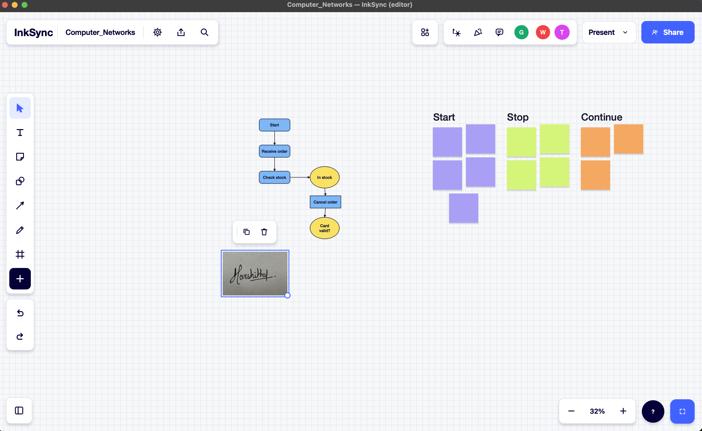

# InkSync

### Think together. Create together. Stay in sync.

<p align="center">
  
</p>

**InkSync** is a LAN-based, multi-user real-time collaborative whiteboard that allows multiple users to draw, communicate and work together on a shared digital canvas.

Built with Python, PySide6 and TCP sockets, InkSync uses a client-server architecture to synchronize whiteboard operations across connected devices in real time.

Unlike cloud-dependent collaboration tools, InkSync is designed to operate entirely over a Local Area Network (LAN), without requiring an active Internet connection.

---

## Features

### Real-Time Collaborative Whiteboard
- Create and join collaborative rooms.
- Draw, erase and create shapes.
- Add text and sticky notes.
- Select and edit canvas objects.
- Insert images into the whiteboard.
- View remote participant cursors.
- Synchronize whiteboard state across connected users.

### Communication and Synchronization
- TCP-based client-server communication.
- Real-time broadcasting of drawing and editing operations.
- Multi-user group chat.
- User identification and timestamps.
- Sequence-based event ordering.
- Shared state synchronization for newly joined participants.

### Room and Session Management
- Create and join rooms.
- Password-protected collaboration rooms.
- Support for multiple participants.
- Handle client connections and disconnections.
- Reconnection and state synchronization.

### History and Export
- Undo and redo operations.
- SQLite-based persistence.
- Export whiteboards as PNG.
- Export whiteboards as PDF.

## Technology Stack

| Component | Technology |
|---|---|
| Programming Language | Python 3.13 |
| GUI Framework | PySide6 |
| Networking | TCP/IP Sockets |
| Data Exchange | JSON |
| Database | SQLite |
| Password Hashing | PBKDF2 |
| Application Packaging | PyInstaller |
| Testing | Python unittest |

## Architecture

InkSync follows a client-server architecture.

**Server**
- Manages collaboration rooms.
- Accepts and handles client connections.
- Processes drawing and chat operations.
- Maintains shared whiteboard state.
- Assigns sequence numbers to operations.
- Broadcasts updates to connected participants.
- Manages persistence and session information.

**Client**
- Provides the graphical interface.
- Connects to the server using TCP sockets.
- Creates and joins rooms.
- Sends drawing and editing operations.
- Receives updates from other participants.
- Displays the shared canvas and chat.
- Supports whiteboard interaction and export.

### Communication Workflow

1. The server starts and listens for incoming TCP connections.
2. A user creates a room or joins an existing room.
3. The client sends user actions to the server.
4. The server processes and orders the operations.
5. The server broadcasts updates to connected participants.
6. Connected clients update their shared whiteboard.

## Project Structure

```text
InkSync/
├── client.py
├── server.py
├── README.md
├── requirements.txt
├── requirements-dev.txt
├── .gitignore
│
├── whiteboard/
│   ├── __init__.py
│   ├── protocol.py
│   └── storage.py
│
├── tests/
│   ├── test_protocol.py
│   ├── test_integration.py
│   └── LAN_MULTI_COMPUTER_TEST.md
│
├── scripts/
│   ├── build_macos.sh
│   ├── build_windows.bat
│   └── build_linux.sh
│
└── screenshots/
    ├── Board_with_image_inserted.png
    ├── board_creation.png
    ├── Chat.png
    ├── Few_available_features.png
    ├── Live_reactions.png
    └── Server.png
```

## Getting Started

### Prerequisites
- Python 3.13
- pip
- macOS, Windows or Linux
- A local Wi-Fi network or LAN for multi-computer collaboration

### 1. Clone the Repository

```bash
git clone YOUR_REPOSITORY_URL
cd InkSync
```

### 2. Create a Virtual Environment

```bash
python3 -m venv .venv
```

Activate on macOS/Linux:

```bash
source .venv/bin/activate
```

Activate on Windows:

```powershell
.venv\Scripts\activate
```

### 3. Install Dependencies

```bash
pip install -r requirements.txt
```

For development and testing:

```bash
pip install -r requirements-dev.txt
```

## Running InkSync

InkSync requires one server and one or more client applications.

### 1. Start the Server

```bash
python server.py --host 0.0.0.0 --port 8765
```

The server listens for incoming connections on TCP port `8765`.

Keep the server running.

### 2. Launch the Client

Open another terminal:

```bash
python client.py
```

Use the connection interface to create a collaboration room.

### 3. Connect Additional Clients

Run the client on another computer:

```bash
python client.py
```

Join the existing room using its room code, password and server IP address.

## Multi-Computer LAN Setup

1. Connect all participating computers to the same Wi-Fi network or mobile hotspot.
2. Start the InkSync server on one computer.
3. Find the server computer's local IP address.
4. Allow incoming TCP connections on port `8765` through the host firewall.
5. Launch the client on the other computers.
6. Enter the server computer's LAN IP address.
7. Join the same collaboration room.

For connections on the same computer, use:

```text
127.0.0.1
```

For connections from another computer, use the server computer's actual LAN IP address.

### Offline LAN Operation

InkSync is designed to function without Internet connectivity.

The local network must remain active so connected computers can communicate.

This can be demonstrated using a Wi-Fi hotspot with mobile data disabled, provided the hotspot allows communication between connected devices.

## Testing

Run the automated test suite:

```bash
python -m unittest discover -s tests -v
```

Additional manual testing scenarios include:

- Multiple users joining the same room.
- Simultaneous drawing and erasing.
- Chat message delivery.
- Undo and redo.
- Client disconnection and reconnection.
- Whiteboard state synchronization.
- Image insertion and export.
- Multi-computer communication over a LAN.
- Collaboration without Internet connectivity.

## Building Standalone Applications

InkSync includes platform-specific build scripts using PyInstaller.

**macOS**

```bash
chmod +x scripts/build_macos.sh
./scripts/build_macos.sh
```

**Windows**

```bat
scripts\build_windows.bat
```

**Linux**

```bash
chmod +x scripts/build_linux.sh
./scripts/build_linux.sh
```

Build on the target operating system and test the generated executable before distribution.

## Database and Persistence

InkSync uses SQLite for local application data and persistence. The database is generated by the application when required. Runtime database files are excluded from the source repository.

## Security Considerations

- Collaboration rooms support password-based access.
- Passwords are processed using PBKDF2-based hashing.
- The server manages shared whiteboard operations.
- Communication is handled using TCP sockets.

**Network security:** The current TCP communication is intended for trusted private LAN environments. TCP itself does not provide encryption. Avoid using the application over untrusted public networks.

## Future Improvements

- Advanced object grouping and manipulation.
- Role-based room permissions.
- Version history and session replay.
- Improved synchronization and conflict handling.
- Encrypted network communication.
- Additional export formats.
- Enhanced cross-platform application packaging.

---

**InkSync — Think together. Create together. Stay in sync.**